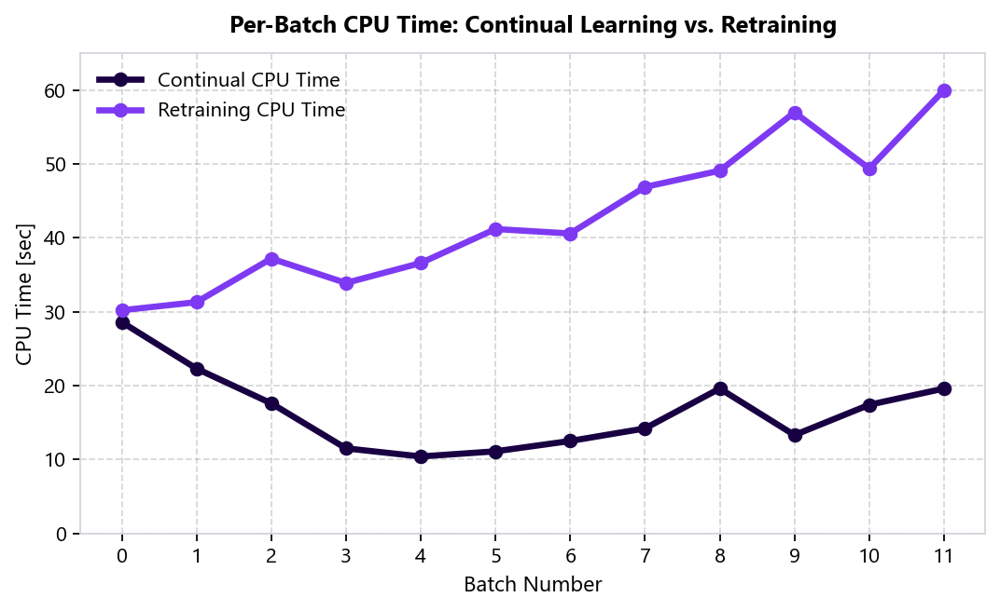
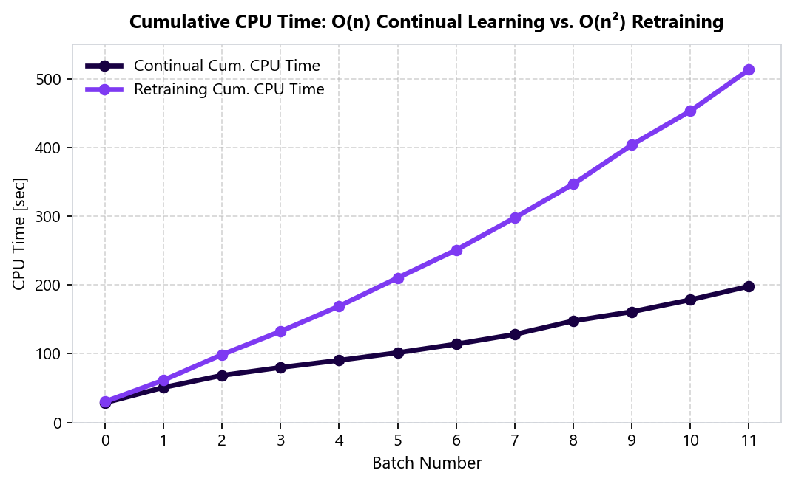

Further Speed-Up with Continual Learning
========================================

*Published: January 24, 2025 — A case study demonstrating how continual training reduces cumulative complexity from O(n²) to O(n).*

Perpetual Learning offers a significant leap forward in machine learning efficiency. Beyond achieving 100x faster initial training compared to traditional hyperparameter-tuned pipelines, ``PerpetualBooster`` enables **continual learning** (``reset=False``) with remarkable speed improvements. This study dives into the empirical performance of continual learning, demonstrating how it empowers continuous model updates while upholding exceptional accuracy.

Experimental Setup (California Housing)
---------------------------------------

Employing the California Housing dataset, we illustrate the potential of continual learning across streaming batches:

1. The dataset is segmented into **24 batches**.
2. **Initial training** (Batch ``0``) utilizes the first 12 batches (``10,320`` samples).
3. **Incremental learning** is performed sequentially across the subsequent 11 batches (``860`` samples per batch).
4. After each incremental step, the model's performance is evaluated on the next unseen batch.
5. To benchmark the efficacy of continual learning, we also train separate models from scratch (``reset=True``) on the cumulative data at each step.

Continual Learning vs. Retraining Results
-----------------------------------------

.. list-table:: Table 1: Continual Learning vs. Retraining
   :header-rows: 1
   :widths: 8 10 16 14 14 16 16 10

   * - Batch #
     - Batch Size
     - Cumulative Data Size
     - Continual CPU Time (s)
     - Retraining CPU Time (s)
     - Continual Cumulative CPU Time (s)
     - Retraining Cumulative CPU Time (s)
     - Speed-up
   * - 0
     - 10,320
     - 10,320
     - 28.6
     - 30.2
     - 28.6
     - 30.2
     - 1.0x
   * - 1
     - 860
     - 11,180
     - 22.3
     - 31.3
     - 50.9
     - 61.5
     - 1.2x
   * - 2
     - 860
     - 12,040
     - 17.6
     - 37.2
     - 68.5
     - 98.7
     - 1.4x
   * - 3
     - 860
     - 12,900
     - 11.5
     - 33.9
     - 80.0
     - 132.6
     - 1.7x
   * - 4
     - 860
     - 13,760
     - 10.4
     - 36.6
     - 90.4
     - 169.2
     - 1.9x
   * - 5
     - 860
     - 14,620
     - 11.1
     - 41.2
     - 101.5
     - 210.4
     - 2.1x
   * - 6
     - 860
     - 15,480
     - 12.5
     - 40.6
     - 114.0
     - 251.0
     - 2.2x
   * - 7
     - 860
     - 16,340
     - 14.2
     - 46.9
     - 128.2
     - 297.9
     - 2.3x
   * - 8
     - 860
     - 17,200
     - 19.6
     - 49.1
     - 147.8
     - 347.0
     - 2.3x
   * - 9
     - 860
     - 18,060
     - 13.3
     - 57.0
     - 161.1
     - 404.0
     - 2.5x
   * - 10
     - 860
     - 18,920
     - 17.4
     - 49.4
     - 178.5
     - 453.4
     - 2.5x
   * - 11
     - 860
     - 19,780
     - 19.6
     - 60.0
     - 198.1
     - 513.4
     - **2.6x**

The findings reveal that continual learning progressively accelerates learning with each incremental step while maintaining a consistent average test Mean Squared Error (MSE) of ``0.197``—matching full retraining from scratch. This translates to a theoretical speed-up that grows unboundedly as the number of incremental steps increases, as visualized in the accompanying charts.

Per-Batch and Cumulative CPU Time Charts
----------------------------------------

The following chart demonstrates the CPU time required at each step. Continual learning exhibits near-constant CPU time with the constant batch size, whereas retraining incurs a linear increase in CPU time as the cumulative dataset grows proportionally:

   Per-batch CPU time (seconds) across Batches 0–11.

The following chart showcases the cumulative CPU time across all steps. Continual learning exhibits a linear :math:`O(n)` growth in cumulative CPU time, while retraining incurs a quadratic :math:`O(n^2)` increase:

   Cumulative CPU time (seconds) across Batches 0–11, illustrating :math:`O(n)` vs. :math:`O(n^2)` scaling.

Conclusion
----------

These results establish ``PerpetualBooster``'s ability to not only deliver 100x faster initial training, but also facilitate continual learning from streaming data in linear time across growing datasets. See :doc:`../continual_learning` for code examples and best practices.

