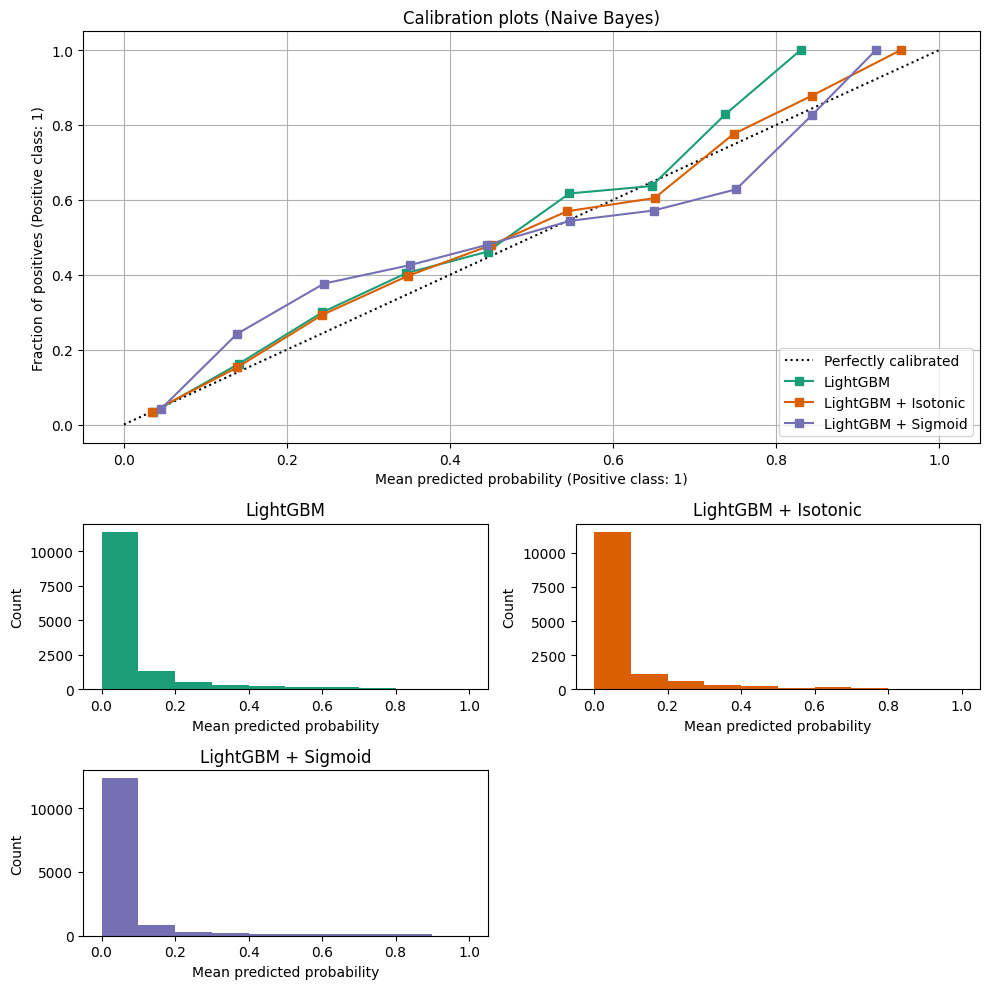

Optimum Business Decisioning with Calibrated Probabilities
==========================================================

*Published: October 27, 2025 — Translating calibrated probability estimates into optimal downstream business decisions.*

In the domain of quantitative decision-making, the transition from predictive modeling to prescriptive action is critical. For high-stakes problems, model accuracy must be effectively translated into maximum **expected utility** or objective fulfillment. This study compares standard modeling pipelines, such as a **Calibrated LightGBM**, against **PerpetualBooster** combined with **Optimum Business Decisioning**.

.. note::

   This analysis uses the publicly available ``TVS_Loan_Default`` dataset from OpenML (`Data ID: 43743 <https://www.openml.org/d/43743>`_) for benchmarking purposes.

The utility of a machine learning model is determined not merely by its predictive metrics (e.g., AUC or F1-score) but by its capacity to inform an optimal **binary action** (e.g., approve or reject). This process requires the determination of a precise **decision threshold** to convert a probability score (e.g., :math:`P(\text{Negative Outcome})`) into a definitive course of action. The optimal threshold isn't just about minimizing classification errors; it is about **maximizing the prescribed business objective**.

----

The Financial Decision Framework: Bridging Prediction and Utility
-----------------------------------------------------------------

To operationalize this utility, we define a clear **business objective function** based on key financial parameters. This function rigorously calculates the expected profit contingent upon the **true outcomes** (:math:`y_{\text{true}}`) and the **predicted probabilities** (:math:`y_{\text{pred}}`) across a range of potential thresholds:

.. code-block:: python

   import numpy as np

   def business_objective(y_true, y_pred, threshold) -> tuple[float, float]:
       interest_rate = 0.12
       # Select loans where predicted probability is below the threshold (approved)
       loan_status = y_true[y_pred < threshold]
       ead = 10000  # Exposure at Default
       capital = ead * len(loan_status)  # Total capital for normalization
       revenue = len(loan_status) * ead * interest_rate
       cost_rate = 0.045  # Cost percentage of EAD for each approved loan
       cost = len(loan_status) * ead * cost_rate
       lgd = 0.7  # Loss Given Default
       loss = np.sum(loan_status) * ead * lgd
       profit = revenue - cost - loss
       margin = (profit / capital) * 100  # Normalize by total exposure

       return profit, margin

This utility function incorporates essential financial components for the loan approval case study:

* **Interest Rate**: ``0.12`` (12%)
* **Exposure at Default (EAD)**: ``$10,000``
* **Cost Rate**: ``0.045`` (4.5% of EAD per approved loan)
* **Loss Given Default (LGD)**: ``0.70`` (70%)

----

Probability Calibration: The Baseline Approach
----------------------------------------------

A standard, high-performance baseline involves not just training a model like **LightGBM**, but also calibrating its output. Prior to threshold optimization, the integrity of the predicted probabilities must be validated: a prediction of ``0.10`` must strictly correspond to a 10% likelihood of default. While LightGBM provides strong discrimination, its native probability estimates often suffer from miscalibration.

   Calibration plots for LightGBM, LightGBM + Isotonic, and LightGBM + Sigmoid, illustrating the fidelity between predicted probabilities and observed frequencies.

For our baseline, we employed scikit-learn's ``CalibratedClassifierCV`` for model refinement, utilizing **Isotonic** and **Sigmoid** post-processing methods to enhance the reliability of probability estimation:

.. list-table:: Expected Calibration Error (ECE) on Baseline LightGBM Variants
   :header-rows: 1
   :widths: 50 50

   * - Model Variant
     - Expected Calibration Error (ECE)
   * - Baseline LightGBM
     - 0.01021
   * - **LightGBM + Isotonic**
     - **0.00622**
   * - LightGBM + Sigmoid
     - 0.01569

The **LightGBM + Isotonic** configuration demonstrated the lowest **Expected Calibration Error (ECE)** of ``0.00622``, establishing it as a trustworthy and robust baseline for subsequent profit optimization.

----

Empirical Results: A Comparative Analysis
-----------------------------------------

We sought the decision threshold that globally maximizes the business objective function on an independent validation set for both the baseline and ``PerpetualBooster``.

Baseline: Calibrated LightGBM
~~~~~~~~~~~~~~~~~~~~~~~~~~~~~

The optimal threshold determined via conventional search methods on the **Calibrated LightGBM** model was **0.104**. This yielded a maximum expected profit of **$5,912,750** on the reserved test set.

PerpetualBooster + Optimum Business Decisioning
~~~~~~~~~~~~~~~~~~~~~~~~~~~~~~~~~~~~~~~~~~~~~~~

In contrast, deploying **PerpetualBooster** combined with **Optimum Business Decisioning** on the identical dataset produced a superior result: **$5,988,250**.

.. important::

   This performance differential represents a **1.3% increase** ($75,500 higher return on the test cohort) in expected financial return over the calibrated LightGBM baseline. Given the scale of global lending operations, a **1.3% improvement** in the core decision mechanism translates directly into multi-million dollar enhancements in annual bottom-line performance.

----

Conclusion
----------

``PerpetualBooster``, paired with native probability calibration (:doc:`../calibration`) and threshold optimization against an explicit business objective, functions not merely as a predictive model, but as a **prescriptive decision engine**. It ensures that every prediction is converted into the most advantageous course of action, maximizing overall utility and directly enhancing organizational objectives.

