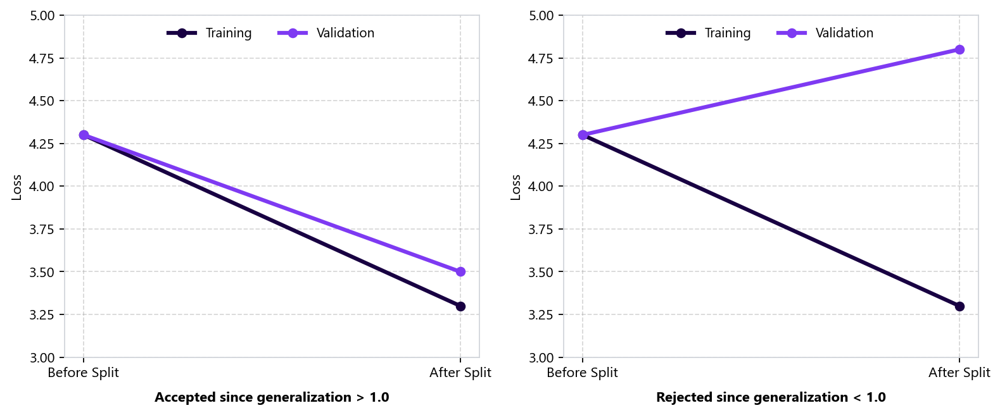

How PerpetualBooster Works
==========================

*Published: July 19, 2025 — A deep dive on how the algorithm eliminates hyperparameter optimization.*

This article dives into the inner workings of ``PerpetualBooster``, a gradient boosting machine that bypasses the need for hyperparameter optimization. It achieves this with two complementary techniques: **step size control** and **generalization control**. The following sections explore how these methods are implemented within the algorithm itself.

Step Size Control
-----------------

Step size control is similar to `backtracking line search <https://en.wikipedia.org/wiki/Backtracking_line_search>`_ with three key differences.

In backtracking line search, the algorithm starts with a very large step size and the step size is repeatedly shrunk until the Armijo–Goldstein condition is fulfilled. In other words, it tries to find a large step size with a sufficient decrease of the objective function by decreasing the step size iteratively:

.. math::

   f(x + \alpha p) \leq f(x) + \alpha c m

1. **Forward-Tracking Tree Search (Smallest Sufficient Step)**

   The first key difference is that we are trying to find the *smallest* step (instead of the largest) to satisfy the condition. We grow the tree split by split and check the loss decrease after every split. If the loss decrease exceeds a certain threshold, we stop growing the tree and continue with the next boosting round. In other words, we are trying to take the smallest step which achieves a target loss decrease at each boosting round. This can be called *forward-tracking tree search*, where :math:`\alpha` is calculated from the user-defined ``budget`` parameter:

   .. math::

      \alpha = 10^{-\text{budget}}

2. **Constant Reference Slope**

   The second key difference is that the :math:`m` parameter is kept constant instead of updating at every step (at every boosting round). :math:`m` is calculated before the fitting process using the base score (initial constant prediction :math:`\hat{y}`):

   .. math::

      m = \frac{1}{n} \sum_{i=1}^{n} \text{loss}(y_i, \hat{y})

3. **Budget-Derived Control Parameter**

   The third key difference is that the control parameter :math:`c` is calculated from the ``budget`` parameter using the following geometric series formula:

   .. math::

      r = \frac{10}{\text{budget}}

   .. math::

      \text{reciprocals of powers} = \frac{r}{r - 1}

   .. math::

      \text{truncated series sum} = \text{reciprocals of powers} - \left(1 + \frac{1}{r}\right)

   .. math::

      c = \frac{1}{r} - \text{truncated series sum}

You can inspect `src/booster/core.rs <https://github.com/perpetual-ml/perpetual/blob/main/src/booster/core.rs>`_ and `src/tree/core.rs <https://github.com/perpetual-ml/perpetual/blob/main/src/tree/core.rs>`_ to review the implementation.

Generalization Control
----------------------

The second technique used to eliminate hyperparameter optimization alongside step size control is **generalization control**. Before each node split, the data is partitioned into internal training and validation folds. We calculate not only the training loss but also the validation loss using the separate validation set:

.. math::

   \text{loss}_{\text{train}} = G_{\text{train}} w + \frac{1}{2} H_{\text{train}} w^2

.. math::

   w = -\frac{G_{\text{train}}}{H_{\text{train}}}

.. math::

   \text{loss}_{\text{valid}} = G_{\text{valid}} w + \frac{1}{2} H_{\text{valid}} w^2

where :math:`G` is the sum of the gradient values, :math:`H` is the sum of the hessian values, and :math:`w` is the leaf weight term.

Using the training and validation losses, we calculate the generalization term:

.. math::

   \text{generalization} = \frac{\text{loss}_{\text{parent}} - \text{loss}_{\text{train}}}{\text{loss}_{\text{parent}} - \text{loss}_{\text{valid}}}

We allow the node to split if ``generalization`` is greater than or equal to ``1.0`` and stop splitting if ``generalization`` is less than ``1.0``. In other words, we check whether the validation loss decreases relative to the parent loss when making the split. The following charts depict this graphically:

   Left: Accepted split where both training loss (4.3 → 3.3) and validation loss (4.3 → 3.5) decrease (:math:`\text{generalization} \geq 1.0`). Right: Rejected split where training loss decreases (4.3 → 3.3) but validation loss increases (4.3 → 4.8) (:math:`\text{generalization} < 1.0`).

See `src/splitter.rs <https://github.com/perpetual-ml/perpetual/blob/main/src/splitter.rs>`_ for the detailed split evaluation implementation.

Conclusion
----------

Finding the right balance between fitting the data and avoiding overfitting is crucial for decision tree learning. This is achieved through two control mechanisms: **step size control** and **generalization control**:

* **Step size control** shines early on. Since the initial splits significantly reduce the loss (error), it is most impactful in the first boosting rounds.
* **Generalization control** becomes more important later. As boosting progresses, trees naturally tend to become shallower because there is less generalizable signal left to learn from the data.
* **Built-in stopping mechanism**: If the algorithm encounters a very simple tree (one split) with poor generalization (less than ``1.0``) three times, it automatically halts the boosting process.

