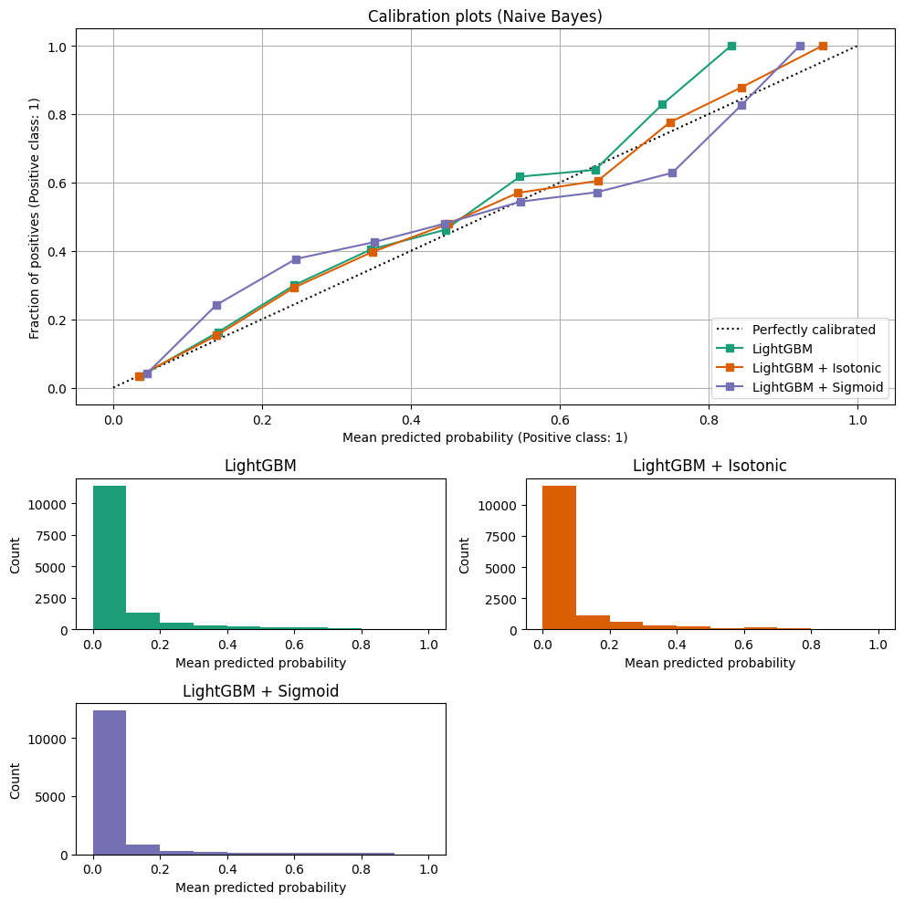

Blog & Case Studies
===================

This section collects engineering deep-dives and empirical case studies exploring how ``PerpetualBooster`` eliminates hyperparameter optimization, accelerates continual training, improves uncertainty quantification, and drives optimal downstream decisions.

.. contents:: On this page
   :local:
   :depth: 2

----

How PerpetualBooster Works
--------------------------

``PerpetualBooster`` eliminates hyperparameter tuning by combining two internal control mechanisms controlled by a single ``budget`` parameter:

1. **Step Size Control (Forward-Tracking Tree Search)**: Inspired by the Armijo–Goldstein condition in backtracking line search, Perpetual grows each tree until it achieves the smallest step that satisfies a target loss reduction proportional to :math:`\alpha = 10^{-\text{budget}}`.
2. **Generalization Control**: At each candidate split, samples are partitioned into internal training and validation folds. Splits are only accepted when the out-of-fold validation loss reduction keeps pace with the training loss reduction (:math:`\text{generalization} \geq 1.0`).

For the full mathematical formulation and links to the Rust implementation, see :ref:`how-perpetual-works` in :doc:`architecture`.

----

100x Faster Initial Training
----------------------------

Effective machine learning model training traditionally requires meticulous hyperparameter tuning (e.g., 100 trials with Optuna) to prevent overfitting. By replacing multi-trial tuning with a single training run governed by the ``budget`` parameter, ``PerpetualBooster`` achieves over **100x speed-ups** compared to tuned `LightGBM` pipelines while matching state-of-the-art accuracy on tabular benchmarks.

California Housing (Regression)
~~~~~~~~~~~~~~~~~~~~~~~~~~~~~~~

On the `California Housing <https://scikit-learn.org/stable/datasets/real_world.html#california-housing-dataset>`_ dataset, ``LightGBM`` uses ``n_estimators`` (alongside Optuna hyperparameter search) to increase model capacity, whereas ``PerpetualBooster`` uses a single ``budget`` parameter. Across three accuracy tiers, ``PerpetualBooster`` exceeds tuned ``LightGBM`` speed by over 100x at equivalent test Mean Squared Error (MSE):

.. list-table:: Table 1: California Housing (Regression) Dataset Results
   :header-rows: 1
   :widths: 15 18 14 14 15 15 12

   * - Perpetual budget
     - LightGBM n_estimators
     - Perpetual MSE
     - LightGBM MSE
     - Perpetual CPU Time (s)
     - LightGBM CPU Time (s)
     - Speed-up
   * - 0.30
     - 100
     - 0.202
     - 0.203
     - 8.8
     - 982
     - **112x**
   * - 0.45
     - 200
     - 0.198
     - 0.198
     - 19.1
     - 2,554
     - **134x**
   * - 0.60
     - 500
     - 0.197
     - 0.197
     - 40.9
     - 6,057
     - **148x**

Forest Cover Types (Classification)
~~~~~~~~~~~~~~~~~~~~~~~~~~~~~~~~~~~

On the `Forest Cover Types <https://scikit-learn.org/stable/datasets/real_world.html#forest-covertypes>`_ classification benchmark, ``PerpetualBooster`` achieves **76x faster** execution speed compared to tuned ``LightGBM`` while maintaining equivalent log loss performance:

.. list-table:: Table 2: Forest Cover Types (Classification) Dataset Results
   :header-rows: 1
   :widths: 15 18 14 14 15 15 12

   * - Perpetual budget
     - LightGBM n_estimators
     - Perpetual Log Loss
     - LightGBM Log Loss
     - Perpetual CPU Time (s)
     - LightGBM CPU Time (s)
     - Speed-up
   * - 0.33
     - 100
     - 0.0886
     - 0.0857
     - 32.2
     - 2,464
     - **76x**

----

Better Prediction Intervals with Perpetual Learning
---------------------------------------------------

Uncertainty quantification via Conformalized Quantile Regression (CQR) provides rigorous prediction intervals with guaranteed coverage. Comparing ``PerpetualBooster`` against the CQR implementation in the open-source `MAPIE <https://mapie.readthedocs.io/>`_ package on the California Housing dataset (target coverage rate of ``0.90``) shows that both methods surpass the target coverage rate, while ``PerpetualBooster`` achieves a **35% reduction** in average prediction interval width:

.. list-table:: Perpetual CQR vs. MAPIE CQR (Target Coverage = 0.90)
   :header-rows: 1
   :widths: 30 20 20 30

   * - CQR Method
     - Target Coverage
     - Actual Coverage
     - Prediction Interval Average Width
   * - MAPIE CQR
     - 0.900
     - 0.905
     - 2.222
   * - **Perpetual CQR**
     - **0.900**
     - **0.907**
     - **1.450**

See :doc:`calibration` for details on post-hoc calibration and native prediction interval methods (``GRP``, ``MinMax``, ``WeightVariance``, and ``Conformal``).

----

Further Speed-Up with Continual Learning
----------------------------------------

Beyond fast initial training, ``PerpetualBooster`` supports continual learning (``reset=False``), reducing cumulative training complexity across streaming batches from quadratic :math:`O(n^2)` to linear :math:`O(n)`.

On the California Housing dataset split into 24 batches (initial fit on the first 12 batches of 10,320 rows, followed by 11 incremental batches of 860 rows each), continual learning maintains the same average test MSE (``0.197``) as retraining from scratch while progressively increasing cumulative speed-up from **1.0x** to **2.6x** by batch 11.

See :doc:`continual_learning` for the full batch-by-batch benchmark table and code examples.

----

Optimum Business Decisioning with Calibrated Probabilities
----------------------------------------------------------

In quantitative decision-making, the value of a model is determined not only by discrimination metrics (such as AUC or F1-score) but by how effectively its predicted probabilities translate into an optimal action that maximizes **expected utility**.

Financial Decision Framework (Loan Default Case Study)
~~~~~~~~~~~~~~~~~~~~~~~~~~~~~~~~~~~~~~~~~~~~~~~~~~~~~~

Using the publicly available ``TVS_Loan_Default`` dataset from OpenML (Data ID: ``43743``), we define a business objective function that computes expected lending profit across candidate approval thresholds given **Interest Rate** (``0.12``), **Exposure at Default (EAD)** (``$10,000``), **Cost Rate** (``0.045``), and **Loss Given Default (LGD)** (``0.70``):

.. code-block:: python

   import numpy as np

   def business_objective(y_true, y_pred, threshold):
       interest_rate = 0.12
       # Approve loans where predicted default probability is below the threshold
       loan_status = y_true[y_pred < threshold]
       ead = 10000  # Exposure at Default
       capital = ead * len(loan_status)  # Total capital for normalization
       revenue = len(loan_status) * ead * interest_rate
       cost_rate = 0.045  # Cost percentage of EAD for each approved loan
       cost = len(loan_status) * ead * cost_rate
       lgd = 0.7  # Loss Given Default
       loss = np.sum(loan_status) * ead * lgd
       profit = revenue - cost - loss
       margin = (profit / capital) * 100  # Normalize by total exposure
       return profit, margin

Probability Calibration Baseline
~~~~~~~~~~~~~~~~~~~~~~~~~~~~~~~~

Before optimizing the decision threshold, predicted probabilities must be well-calibrated (e.g., a predicted probability of ``0.10`` must correspond to a 10% observed default rate). Using scikit-learn's ``CalibratedClassifierCV`` on a tuned ``LightGBM`` baseline:

   Calibration plots for uncalibrated LightGBM, LightGBM + Isotonic, and LightGBM + Sigmoid, illustrating the alignment between predicted probabilities and observed default frequencies.

.. list-table:: Expected Calibration Error (ECE) on Baseline LightGBM Variants
   :header-rows: 1
   :widths: 50 50

   * - Model Variant
     - Expected Calibration Error (ECE)
   * - Baseline LightGBM
     - 0.01021
   * - **LightGBM + Isotonic**
     - **0.00622**
   * - LightGBM + Sigmoid
     - 0.01569

Empirical Profit Comparison
~~~~~~~~~~~~~~~~~~~~~~~~~~~

Selecting the decision threshold on an independent validation set to maximize ``business_objective`` and evaluating on the reserved test set:

* **Calibrated LightGBM (Isotonic)**: Optimal threshold of ``0.104``, yielding a total expected profit of **$5,912,750**.
* **PerpetualBooster + Calibration & Threshold Optimization**: Yields a total expected profit of **$5,988,250**—a **1.3% increase** in expected financial return ($75,500 higher profit on the test cohort) over the calibrated LightGBM baseline.

----

Profit-Driven Lead Scoring
--------------------------

Traditional classification pipelines optimize statistical metrics without accounting for asymmetric business costs and benefits. By incorporating explicit financial payoffs into threshold selection on calibrated ``PerpetualBooster`` probabilities, marketing campaigns can directly maximize net profit.

Financial Payoff Matrix (Bank Marketing Case Study)
~~~~~~~~~~~~~~~~~~~~~~~~~~~~~~~~~~~~~~~~~~~~~~~~~~~

On the UCI **Bank Marketing** dataset, we evaluate campaign profit using the following per-lead financial parameters:

.. list-table:: Lead Scoring Payoff Parameters
   :header-rows: 1
   :widths: 25 15 60

   * - Outcome
     - Value ($)
     - Description
   * - **True Positive (TP)**
     - +$1,000
     - Financial gain from a successful conversion (Good Lead → Customer).
   * - **False Positive (FP)**
     - -$100
     - Cost of sales time wasted on a non-converting lead (Bad Lead → Sales Effort).
   * - **False Negative (FN)**
     - -$500
     - Opportunity cost of a missed conversion (Good Lead → No Sales Effort).

Campaign Profit Results
~~~~~~~~~~~~~~~~~~~~~~~

* **LightGBM + CalibratedClassifierCV**: Achieves a total campaign profit of **$733,200**.
* **PerpetualBooster**: Delivers a total campaign profit of **$740,600**—a **1.0% increase** in net campaign profitability on the same objective.
