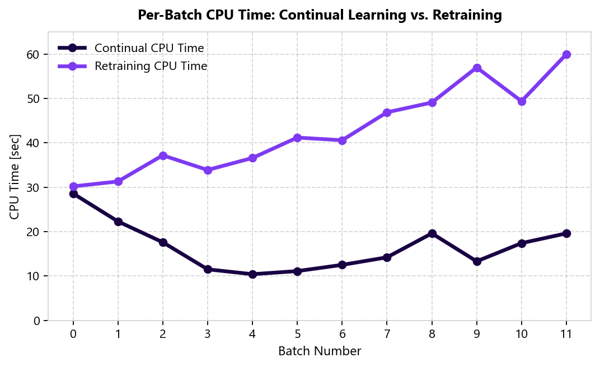
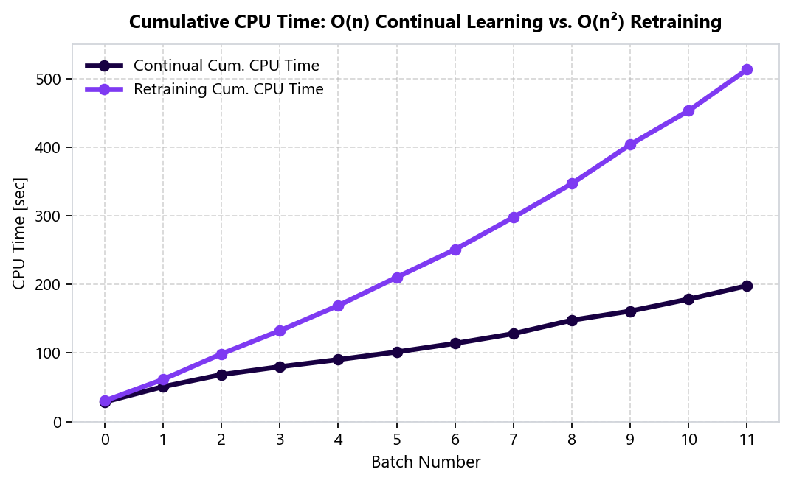

Continual Learning
==================

PerpetualBooster supports continual learning, allowing you to update an existing model with new data without retraining from scratch. This is particularly useful for streaming data or when you receive data in batches over time.

Mechanism
---------

In Perpetual, continual learning is implemented by maintaining the state of the model (including all previously trained trees) and adding new trees to correct the residual errors on the new data.

To enable continual learning, you must initialize the ``PerpetualBooster`` with ``reset=False``.

.. code-block:: python

    import pandas as pd

    # Initialize with reset=False to enable continual updates
    model = PerpetualBooster(objective="SquaredLoss", budget=1.0, reset=False)

    # First batch
    model.fit(X_batch1, y_batch1)

    # Second batch
    # IMPORTANT: Provide CUMULATIVE data to prevent catastrophic forgetting
    # The model uses existing trees for initial predictions and adds new trees for residuals.
    X_cumulative = pd.concat([X_batch1, X_batch2])
    y_cumulative = pd.concat([y_batch1, y_batch2])

    model.fit(X_cumulative, y_cumulative)

By default (``reset=True`` or default), calling ``fit`` will discard any previous training and start from scratch.

Warm Start vs Retraining
------------------------

- **Retraining (reset=True)**: The model is discarded and a new one is built from scratch using the provided data.
  
  - **Method**: Discard old model, train new model on all available data (cumulative).
  - **Total Complexity**: **O(n²)**, where *n* is the final dataset size.
  - **Why?**: You re-learn the same patterns repeatedly as the dataset grows.

- **Continual Learning (reset=False)**: The existing trees are kept, and new trees are added to reduce the error on the provided data.
  
  - **Method**: Keep existing model, update with all available data (cumulative).
  - **Total Complexity**: **O(n)**, where *n* is the final dataset size.
  - **Metrics**: **Maintains the same average metrics (e.g., MSE)** as retraining from scratch.
  - **Why?**: The model uses existing trees to explain the majority of the data and only adds new trees to correct residual errors on the new data or distributional shifts.

Performance Considerations
--------------------------

When performing continual learning, it is **critical** to provide **cumulative data** (all data seen so far) to the ``fit`` method, even when ``reset=False``. Perpetual uses the existing trees to make predictions on the cumulative data and then adds new trees to correct the errors. This prevents catastrophic forgetting and ensures the model remains accurate on the entire distribution.

If you only provide the *new* batch of data with ``reset=False``, the model will focus on minimizing error for that specific batch, which effectively forgets the patterns learned from previous batches.

Example
-------

A full example demonstrating continual learning and comparing it with retraining is available in the examples directory:

`examples/continual_learning.py <https://github.com/perpetual-ml/perpetual/blob/main/package-python/examples/continual_learning.py>`_

The example simulates a streaming scenario using the California Housing dataset (fetched from sklearn):

1. Trains an initial model on a subset of data.
2. Iteratively receives new batches of data.
3. Compares **Continual Learning** (warm start) vs **Retraining** at each step.

Results typically show that Continual Learning is significantly faster while maintaining competitive accuracy (MSE).

Benchmark: Continual Learning vs. Retraining
--------------------------------------------

Using the California Housing dataset segmented into 24 batches, initial training is performed on the first 12 batches (10,320 samples), followed by incremental learning across 11 subsequent batches of 860 samples each. After each incremental step, the model is evaluated on the next batch and compared against a model retrained from scratch on the cumulative dataset.

.. list-table:: Continual Learning vs. Retraining on California Housing
   :header-rows: 1
   :widths: 8 10 16 14 14 16 16 10

   * - Batch #
     - Batch Size
     - Cumulative Data Size
     - Continual CPU Time (s)
     - Retraining CPU Time (s)
     - Continual Cum. CPU Time (s)
     - Retraining Cum. CPU Time (s)
     - Speed-up
   * - 0
     - 10,320
     - 10,320
     - 28.6
     - 30.2
     - 28.6
     - 30.2
     - 1.0x
   * - 1
     - 860
     - 11,180
     - 22.3
     - 31.3
     - 50.9
     - 61.5
     - 1.2x
   * - 2
     - 860
     - 12,040
     - 17.6
     - 37.2
     - 68.5
     - 98.7
     - 1.4x
   * - 3
     - 860
     - 12,900
     - 11.5
     - 33.9
     - 80.0
     - 132.6
     - 1.7x
   * - 4
     - 860
     - 13,760
     - 10.4
     - 36.6
     - 90.4
     - 169.2
     - 1.9x
   * - 5
     - 860
     - 14,620
     - 11.1
     - 41.2
     - 101.5
     - 210.4
     - 2.1x
   * - 6
     - 860
     - 15,480
     - 12.5
     - 40.6
     - 114.0
     - 251.0
     - 2.2x
   * - 7
     - 860
     - 16,340
     - 14.2
     - 46.9
     - 128.2
     - 297.9
     - 2.3x
   * - 8
     - 860
     - 17,200
     - 19.6
     - 49.1
     - 147.8
     - 347.0
     - 2.3x
   * - 9
     - 860
     - 18,060
     - 13.3
     - 57.0
     - 161.1
     - 404.0
     - 2.5x
   * - 10
     - 860
     - 18,920
     - 17.4
     - 49.4
     - 178.5
     - 453.4
     - 2.5x
   * - 11
     - 860
     - 19,780
     - 19.6
     - 60.0
     - 198.1
     - 513.4
     - 2.6x

Across all incremental updates, continual learning maintains the same average test Mean Squared Error (MSE of ``0.197``) as full retraining while exhibiting near-constant per-batch CPU time and linear :math:`O(n)` cumulative training time compared to the quadratic :math:`O(n^2)` growth of retraining from scratch.

   Per-batch CPU time across batches 0–11. Continual learning stays roughly constant per batch, whereas retraining CPU time increases linearly with cumulative data size.

   Cumulative CPU time across batches 0–11, demonstrating linear :math:`O(n)` scaling for continual learning vs. quadratic :math:`O(n^2)` scaling for retraining.

See :doc:`blog/continual` for the full benchmark article.
